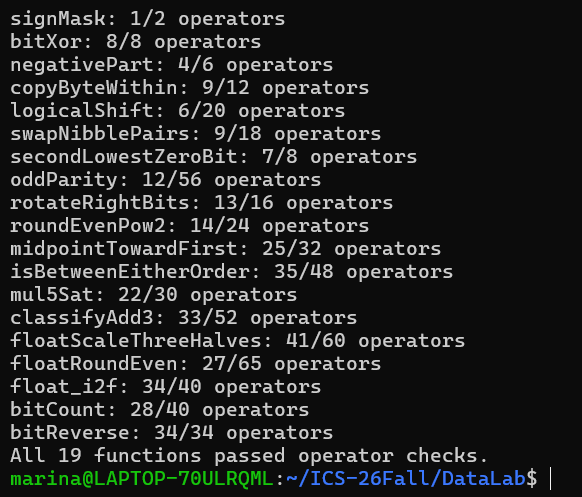
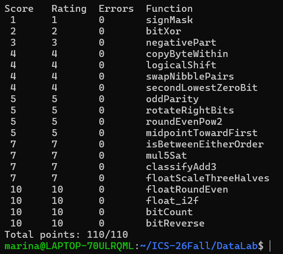

# Lab1: DataLab 实验报告

**姓名：** 许波婧  
**学号：** 25303060076  
**课程：** ICS 2026 Fall  
**实验：** Lab1 DataLab  

---

## 1. 实验目的

本实验通过限制 C 语言中可使用的运算符，使我从位级表示的角度理解整数和浮点数的底层实现。

实验主要涉及以下内容：

- 32 位二进制补码整数表示；
- 位移、掩码以及位运算；
- 有符号整数的溢出判断；
- 不使用比较运算实现条件判断；
- IEEE 754 单精度浮点数的表示；
- round-to-nearest-even 舍入规则；
- 整数与浮点数之间的位级转换；
- 并行位计数与位反转。

本实验共完成 P1–P19 共 19 个函数，并使用课程提供的 operator checker、btest 和 test.sh 完成验证。

---

## 2. 实验环境

实验在 Windows WSL Ubuntu 环境中完成。

主要使用：

- GCC
- Make
- Python 3
- VS Code
- Git / GitHub

首先使用课程提供的模板仓库创建个人仓库，并通过 SSH clone 到本地。

编译和测试使用：

```bash
make clean
make all
./btest
./check_ops.py bits.c
./test.sh
```

最终 `./test.sh` 返回值为 `0`，说明完整本地测试通过。

---

## 3. 各题实现思路

### P1 `signMask`

目标是生成仅最高位为 1 的 32 位整数，即 `0x80000000`。

32 位整数最高位是 bit31，因此从常量 1 出发左移 31 位即可：

```text
1 << 31
```

这样既避免直接使用较大的常量，也满足运算符限制。

---

### P2 `bitXor`

题目要求实现异或，但只能使用 `~` 和 `&`。

根据异或定义：

```text
x XOR y
= (x AND NOT y) OR (NOT x AND y)
```

再利用德摩根律：

```text
A OR B = ~(~A & ~B)
```

因此可以完全使用 `~` 和 `&` 构造异或。

---

### P3 `negativePart`

如果 `x < 0`，返回 `-x`；否则返回 0。

利用算术右移：

```text
x >> 31
```

当 `x >= 0` 时得到全 0 mask，当 `x < 0` 时得到全 1 mask。

另一方面，补码中：

```text
-x = ~x + 1
```

因此将 `-x` 与符号 mask 按位与即可在负数时保留结果，在非负数时得到 0。

---

### P4 `copyByteWithin`

本题需要将一个 32 位整数中的某个字节复制到另一个字节位置。

首先通过：

```text
src << 3
dst << 3
```

得到对应字节的 bit 偏移量。

然后利用 `0xFF` 提取源字节，再利用：

```text
~(0xFF << dstShift)
```

清空目标字节。

最后把源字节移动到目标位置并通过 OR 拼回原整数。

整体过程可以概括为：

```text
提取源字节 → 清空目标字节 → 移位 → 拼接
```

---

### P5 `logicalShift`

C 中对有符号负整数使用 `>>` 会进行算术右移，高位补 1。

本题需要逻辑右移，因此先执行普通右移，再构造一个高 n 位为 0、其余位为 1 的 mask。

最后：

```text
算术右移结果 & mask
```

即可清除由符号扩展产生的高位 1。

---

### P6 `swapNibblePairs`

1 byte 包含两个 4 bit 的 nibble。

本题要求每个字节中高 4 位和低 4 位互换。

先构造：

```text
0x0F0F0F0F
```

作为 mask。

低 4 位通过：

```text
(x & mask) << 4
```

移动到高半字节。

高 4 位通过：

```text
(x >> 4) & mask
```

移动到低半字节。

最后使用 OR 合并。

---

### P7 `secondLowestZeroBit`

首先对 `x` 取反：

```text
y = ~x
```

这样“寻找第二低的 0”就转化为“寻找第二低的 1”。

经典位运算：

```text
y & (y - 1)
```

可以清除最低的 1。

由于不能直接使用减法，用：

```text
y + ~0
```

表示 `y - 1`。

清除最低 1 后，再使用：

```text
z & -z
```

提取新的最低 1，从而得到原数中第二低的 0 所在位置。

---

### P8 `oddParity`

利用 XOR 可以判断一组 bit 中 1 的个数奇偶性。

通过连续折叠：

```text
32 bit → 16 bit → 8 bit → 4 bit → 2 bit → 1 bit
```

具体使用：

```text
x ^ (x >> 16)
x ^ (x >> 8)
...
```

最终最低位表示原整数中 1 的数量是奇数还是偶数。

由于题目要求偶数个 1 时返回 1，因此最后再使用逻辑非。

---

### P9 `rotateRightBits`

循环右移与普通右移不同，右侧移出的 bit 需要从左侧重新进入。

首先通过：

```text
n & 31
```

将移位量限制在 0–31。

然后得到逻辑右移部分，再把原整数低 n 位左移到高位。

最终：

```text
rightPart | leftPart
```

得到循环右移结果。

实现中特别避免了 `x << 32` 这种未定义情况。

---

### P10 `roundEvenPow2`

本题要求将 `x` 舍入到最近的 `2^n` 倍数，并在恰好一半时采用 round-to-nearest-even。

首先计算：

```text
half = 2^(n-1)
```

普通舍入可以通过增加 bias 后清除低 n 位实现。

为了处理 ties-to-even，bias 使用：

```text
half - 1 + 当前商的最低位
```

如果当前商是偶数，halfway 时不进位；如果当前商为奇数，则进位到下一个偶数。

---

### P11 `midpointTowardFirst`

不能直接计算：

```text
(x + y) / 2
```

因为 `x + y` 可能溢出。

使用经典无溢出平均值：

```text
(x & y) + ((x ^ y) >> 1)
```

可以得到数学中点向下取整的值。

如果中点恰好为 `.5`，则根据题目要求向第一个参数 `x` 舍入。

因此进一步判断：

- 是否为半整数；
- `x` 是否大于 `y`。

若两者同时成立，则在 floor midpoint 上加 1。

---

### P12 `isBetweenEitherOrder`

本题不确定 `a` 和 `b` 的大小顺序。

因此不直接寻找 min/max，而是判断：

```text
x 是否同时小于 a 和 b
```

以及：

```text
x 是否同时大于 a 和 b
```

如果两个条件都不成立，则说明 x 位于两个端点之间。

为了防止 `x-a` 在异号情况下发生溢出，比较时首先判断符号是否不同，再决定是否使用差值符号。

---

### P13 `mul5Sat`

首先计算：

```text
2x
4x
5x = 4x + x
```

每一步都检测有符号溢出。

两个同号整数相加，如果结果符号改变，则说明发生有符号溢出。

一旦检测到溢出：

- 正数返回 `INT_MAX`；
- 负数返回 `INT_MIN`。

否则返回正常的 `5*x`。

这种方式实现了 saturation arithmetic。

---

### P14 `classifyAdd3`

本题需要判断数学意义上的：

```text
x + y + z
```

是否超过 32 位有符号整数范围。

不能简单依据中间加法是否溢出，因为中间溢出可能被第三个数抵消。

因此模拟多字长加法，分别计算低 32 位和进位信息。

通过输入符号扩展、两次加法产生的 carry，以及最终结果符号，可以判断真实数学结果的高位。

最终：

- 高于 `INT_MAX` 返回 1；
- 低于 `INT_MIN` 返回 -1；
- 否则返回 0。

---

### P15 `floatScaleThreeHalves`

IEEE 754 单精度浮点数由：

```text
sign | exponent | fraction
```

组成。

先拆出三个字段，根据 exponent 分类处理：

- `exp == 255`：NaN 或 Infinity，原样返回；
- `exp == 0`：0 或非规格化数；
- 其他：规格化数。

对于规格化数，需要恢复隐藏的 leading 1。

计算乘以 `3/2` 时同时处理：

- 尾数乘 3；
- 指数是否需要增加；
- denormal 到 normal 的转换；
- round-to-nearest-even；
- overflow 到 Infinity。

---

### P16 `floatRoundEven`

本题将浮点数舍入到最近整数，但返回值仍然是对应 float 的位模式。

根据 exponent 判断：

- `|f| < 0.5`：返回带原符号的 0；
- `0.5 <= |f| < 1`：区分恰好 0.5 与大于 0.5；
- 数值已经没有小数部分：直接返回；
- 其他情况：计算需要舍弃的小数 bit。

比较被舍弃部分与 halfway：

```text
rem < half  → 向下
rem > half  → 向上
rem = half  → 根据保留整数的奇偶性决定
```

从而实现 round-to-nearest-even。

---

### P17 `float_i2f`

本题手工实现 `int` 到 IEEE 754 单精度浮点位模式的转换。

首先确定：

```text
sign
absolute magnitude
```

并特别处理 `INT_MIN`，使用 unsigned 保存其绝对值。

随后找到最高有效 1 的位置，从而得到 exponent。

如果整数有效位不超过 24 位，可以精确转换。

如果超过 24 位，则必须丢弃低位，并根据：

```text
remaining bits
halfway
最低保留位的奇偶性
```

执行 round-to-nearest-even。

如果舍入导致 significand 进位，则 exponent 进一步增加。

---

### P18 `bitCount`

本题统计 32 位整数中 1 的个数，但不能使用循环。

使用 parallel bit count 方法。

依次构造：

```text
0x55555555
0x33333333
0x0F0F0F0F
```

然后分阶段合并计数：

```text
每 2 bit
→ 每 4 bit
→ 每 8 bit
→ 每 16 bit
→ 32 bit
```

最终最低若干位即为整个 32 位整数中的 1 的数量。

---

### P19 `bitReverse`

本题要求将整个 32 位整数的 bit 顺序完全反转。

采用分层交换的方法：

```text
交换相邻 1 bit
交换相邻 2 bit
交换相邻 4 bit
交换相邻 8 bit
交换左右 16 bit
```

使用的主要 mask 为：

```text
0x55555555
0x33333333
0x0F0F0F0F
0x00FF00FF
0x0000FFFF
```

为了满足常量与运算符数量限制，这些 mask 通过较小常量和位运算递推构造。

最终运算符数量恰好满足题目的限制。

---

## 4. 测试结果

### 4.1 Operator Check

执行：

```bash
./check_ops.py bits.c
```

所有 19 个函数均通过运算符规则检查。



### 4.2 Functional Test

执行：

```bash
./btest
```

19 个函数均无错误，最终得到：

```text
Total points: 110/110
```



此外执行：

```bash
./test.sh
```

并检查：

```bash
echo $?
```

返回：

```text
0
```

说明完整本地自动测试成功。

---

## 5. 实验总结

DataLab 与普通 C 语言编程最大的区别是，很多平时可以直接使用的高级操作在本实验中都受到限制，因此必须从二进制表示本身出发思考问题。

在整数部分，我进一步理解了补码、算术右移、mask、符号扩展和有符号溢出的实际含义。例如 `x >> 31` 不仅能够获取符号信息，还可以直接生成全 0 或全 1 的条件 mask。很多看似需要条件语句的操作都可以转换为位级运算。

在浮点部分，我对 IEEE 754 单精度浮点数的结构有了更清晰的认识。尤其是在处理 `floatScaleThreeHalves`、`floatRoundEven` 和 `float_i2f` 时，需要明确理解 sign、exponent、fraction、隐藏的最高有效位以及 round-to-nearest-even 的具体行为。

最后两题中的 parallel bit count 和分层 bit reverse 也体现了位运算的并行性：不需要逐 bit 循环，而是可以通过多个 mask 和几次移位同时处理大量 bit。

通过本次实验，我对计算机如何在底层表示和操作整数、浮点数有了比直接使用 C 运算符更深入的理解。

---

## 6. 参考资料与辅助工具

1. ICS 2026 Fall Lab1 DataLab 实验文档及课程模板代码。
2. Randal E. Bryant, David R. O'Hallaron, *Computer Systems: A Programmer's Perspective*, Chapter 2: Representing and Manipulating Information.
3. IEEE 754 floating-point representation 与 round-to-nearest-even 相关知识。
4. ChatGPT：用于辅助理解补码、位运算、溢出判断、IEEE 754 和各题算法思路，并辅助检查实现逻辑。最终代码均使用课程提供的本地测试、operator checker 和自动测试进行验证。

---

## 7. 最终结果

- `./check_ops.py bits.c`：19 个函数全部通过规则检查；
- `./btest`：`110/110`；
- `./test.sh`：返回值 `0`；
- `.github` workflow 未修改；
- 最终提交包含 `bits.c`、实验报告和测试截图。
